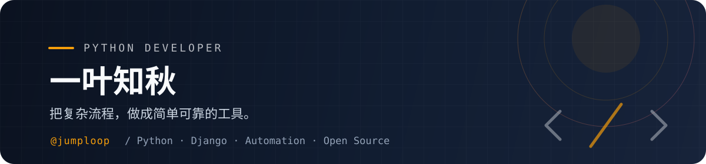

  

<h1 align="center">你好，我是一叶知秋 👋</h1>

  <strong>Python 开发工程师</strong> 
  Web 开发 · 自动化运维 · 数据采集 · 效率工具

  
  
  

---

### 👨‍💻 关于我

- 🔭 专注 **Python Web 开发、自动化脚本与效率工具**
- 🌱 持续整理 **Python 学习资料、爬虫与工程实践**
- 🧰 喜欢用简单可靠的方案，解决真实、重复的问题
- 📚 相信好代码和好文档同样重要

### 🛠️ 技术栈

  
  
  
  
  
  
  
  
  
  
  
  

### 🚀 代表项目

| 项目 | 简介 |
| --- | --- |
| **[Python_Books](https://github.com/jumploop/Python_Books)** | Python 入门与进阶书籍、学习资料整理 |
| **[book_demo](https://github.com/jumploop/book_demo)** | Django + Vue 前后端分离开发入门 |
| **[animation_information](https://github.com/jumploop/animation_information)** | 按月份展示日本新番资讯与番剧列表 |
| **[Write-high-quality-Python-code](https://github.com/jumploop/Write-high-quality-Python-code)** | 《编写高质量代码》示例整理，升级为 Python 3 |
| **[Python3_WebSpider](https://github.com/jumploop/Python3_WebSpider)** | Python 3 爬虫练习与实战案例 |
| **[cheap-vps-racknerd](https://github.com/jumploop/cheap-vps-racknerd)** | RackNerd 高性价比 VPS 优惠活动整理 |

  

### 🧭 资源与推荐

- 🚀 [RackNerd 高性价比便宜 VPS 最新优惠活动](https://jumploop.github.io/cheap-vps-racknerd/)
- ☁️ [Vultr 优惠链接](https://www.vultr.com/?ref=7521090) · [赠送 300 美元体验额度](https://www.vultr.com/?ref=9655894-9J)
- 🧾 [搬瓦工优惠码 BWHCGLUKKB（-6.77%）](https://bandwagonhost.com/aff.php?aff=78937&pid=44)
- 🌐 [69 云机场：每日签到免费送流量](https://69yun69.com/auth/register?code=dKhmtr)
- 🔖 [NameSilo 域名优惠链接](https://www.namesilo.com/domain/search-domains?rid=9ca7f87to)，优惠码：`xiaoming`

  感谢访问，欢迎从感兴趣的项目开始逛逛。

